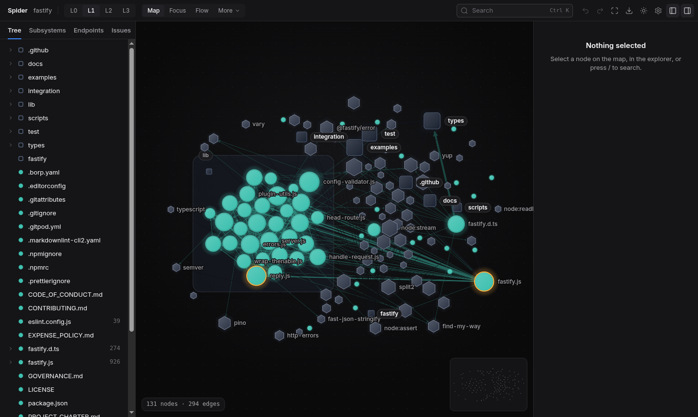
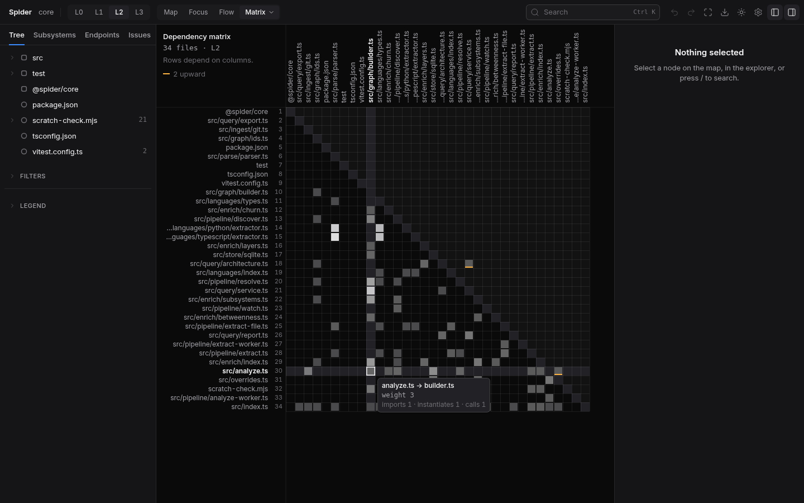
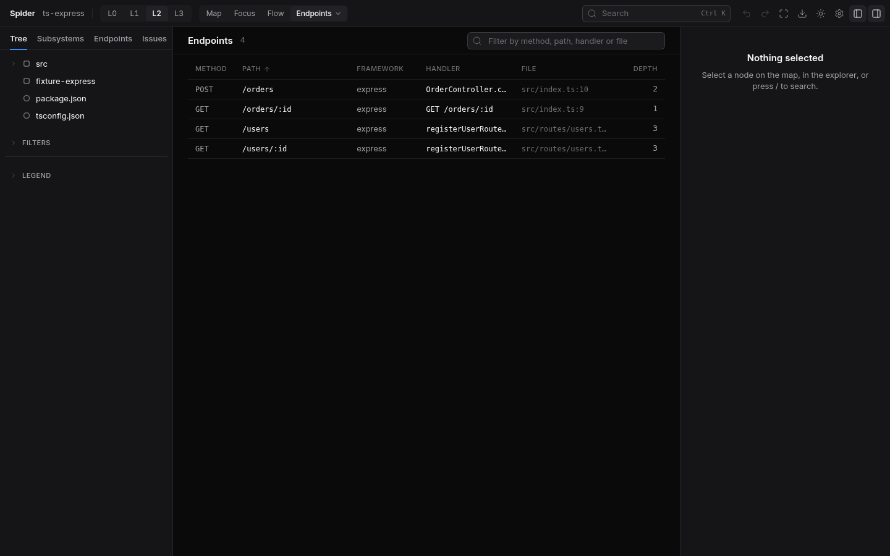

# Spider

**See how your codebase is connected.**

Spider analyses a repository (a local path, a git URL or `owner/repo`) and builds a semantic graph of its
directories, files, classes, functions, imports, calls, inheritance, endpoints, datastores and cross-service HTTP
calls. You explore it as an interactive map: zoom from subsystems down to single methods, trace a request from its
route to the database, see what breaks if a function changes, or ask questions in plain English.



## Highlights

- **Eight languages.** TypeScript, JavaScript, Python, Go, Rust, Java, Kotlin and C# are fully supported: imports,
  symbols, calls, inheritance and typed receivers are resolved without guessing. Endpoints are detected for
  Express, Fastify, Koa, Hono, NestJS, Next.js, FastAPI, Flask, Django, net/http, Gin, Echo, Chi, gorilla, gRPC,
  Axum, Actix, Rocket, Spring and ASP.NET Core.
- **Polyglot linking.** HTTP client calls (fetch, axios, requests, httpx, `http.Get`, RestTemplate, HttpClient …)
  are matched to the endpoints they hit in any language. SQL strings, ORMs (Prisma, TypeORM, Sequelize, SQLAlchemy,
  Django, GORM, JPA, EF Core), Redis and queues become datastore nodes with reads and writes.
- **Architecture intelligence.** Spider infers subsystems, then layers them and flags layer violations. It reports
  import cycles, dead code, god modules, git churn and betweenness, and shows a dependency matrix. Subsystems can
  be renamed, merged or pinned.
- **Views.** Map (four zoom levels), Focus, Flow (upstream, downstream, path, endpoint trace), Matrix, Endpoints,
  Externals and Issues, plus a source viewer with clickable call sites.
- **Scale.** grafana/grafana (3.0M lines of Go + TypeScript) analyses in about a minute on a laptop. A 20,000-node
  view pans at 60 fps.
- **Diff and PR mode.** `spider diff --base main` reports added and removed dependencies and new cycles, as
  Markdown ready for a PR comment. The map can show the same diff.
- **Semantic layer (opt-in).** It adds summaries, **Ask Spider** (answers that cite graph nodes and reveal them on
  the map), search by meaning, a generated onboarding document and a guided tour. It works with Claude,
  any OpenAI-compatible endpoint, or a local Ollama. Nothing leaves your machine unless you configure a provider.
- **MCP server.** `spider mcp` gives Claude Code, Claude Desktop, Cursor and other agents the same graph tools.
- **Hosted mode.** Optional accounts, workspaces, invites, read-only share links and background workers on
  Postgres, started with `docker compose up`.
- **VS Code extension.** Opens the map beside your code and reveals the symbol under the cursor.

Analysis is local and read-only. Spider never executes the code it reads and never reads outside the analysed
repository.

| | |
|---|---|
|  |  |
|  |  |

## Download

Get the desktop app for **Windows** or **Linux** from the
[latest release](https://github.com/PraneethReddy-github/Spider/releases/latest). It needs no Node or setup:

- **Windows:** `Spider-Setup-<version>.exe` (or `Spider-Portable-<version>.exe` without installing)
- **Linux:** `Spider-<version>-x86_64.AppImage` (`chmod +x` it, then run it), or the `.deb` for Debian/Ubuntu

The installer and AppImage update themselves from GitHub Releases. Install `git` to analyse GitHub URLs; local
folders work without it.

## Quick start (from source)

Requires Node 20+ and pnpm 9.

```bash
pnpm install
pnpm build
alias spider="node $PWD/packages/cli/dist/index.js"

spider analyze fixtures/ts-express     # a path, a git URL or owner/repo
spider open                            # serves http://127.0.0.1:4747 and opens it
```

You can also run `spider serve` and paste a path or GitHub URL on the home page. Set `GITHUB_TOKEN` for private
repositories.

| Key | Action |
|-----|--------|
| `⌘K` / `/` | Search (toggle **By meaning** for semantic search) |
| `1`–`4` | Level L0–L3 |
| `F` / `Shift+F` | Fit all / fit selection |
| `U` / `D` | Upstream / downstream of the selection |
| `P` | Path between two nodes |
| `H` / `Shift+H` | Hide selection / show hidden |
| `←` / `→` | Previous / next tour step |
| `Esc` | Clear selection, close overlays |

## Command line

```bash
spider analyze <path|url|owner/repo> [--ref <ref>] [--name <name>] [--json]
spider list | stats <repo>
spider query <repo> search|upstream|downstream|path|endpoints|diagnostics|subsystems …
spider export <repo> --format json|dot|graphml [-o file]
spider report <repo> [--narrative] [-o file]        # "Architecture of X" in Markdown
spider diff [repo|path] --base main [--format md|json]
spider summarize <repo> [--limit 40] [--force]       # model summaries (opt-in)
spider embed <repo>                                  # embeddings for semantic search (opt-in)
spider mcp [repo]                                    # MCP server over stdio
spider serve [-p 4747] [--host 127.0.0.1] [--watch]
spider worker                                        # hosted mode: process queued analyses
spider open
```

`--home <dir>` (or `SPIDER_HOME`) works with every command. The default is `~/.spider`.

## Model features (opt-in)

```bash
export SPIDER_LLM_PROVIDER=anthropic        # or openai, ollama
export ANTHROPIC_API_KEY=…                  # Claude; default model claude-opus-5-5
# export SPIDER_LLM_MODEL=… SPIDER_LLM_BASE_URL=… SPIDER_EMBED_MODEL=…   for OpenAI-compatible / Ollama
spider serve
```

Then use **More ▾ → Ask Spider…**, the **Summarize** button in the Details panel, **More ▾ → Take the tour**, and
**Export → Onboarding document**. See [docs/API.md](docs/API.md#semantic-layer-phase-5).

## Use it from an agent (MCP)

```bash
claude mcp add spider -- spider mcp
```

Tools: `search`, `node_detail`, `upstream`, `downstream`, `path`, `endpoints`, `trace`, `subsystems`,
`diagnostics`, `source`, `list_repos`. Configuration for other clients is in [docs/MCP.md](docs/MCP.md).

## Hosted mode

```bash
SPIDER_SECRET=$(openssl rand -base64 32) docker compose up --build
```

Open http://localhost:4747 and create the first account. Invite teammates from **Settings**, and share read-only
links from **Export**. Details, environment variables and access rules are in [docs/HOSTED.md](docs/HOSTED.md).

## Graph diff in CI

`spider diff --base main` builds the base revision from `git archive`, so your working tree is never touched. It
prints new and removed dependencies, cycles and layer violations.
[`docs/examples/spider-diff.yml`](docs/examples/spider-diff.yml) is a GitHub workflow that posts that summary as a
PR comment.

## Development

Desktop app: `pnpm --filter spider-desktop start` runs it from source; `pnpm --filter spider-desktop run dist:linux`
(or `dist:win` on Windows) builds installers into `packages/desktop/release/`. Pushing a `v*.*.*` tag builds both
platforms in GitHub Actions and publishes the release that installed apps update from.

```bash
pnpm dev         # API on :4747 and Vite on :5173 (proxying /api)
pnpm typecheck
pnpm test
pnpm lint
pnpm bench       # pipeline timings
```

```
packages/shared   graph model, API types and request schemas
packages/core     discover → parse → extract → resolve → enrich → persist → query; llm/, mcp, diff
packages/server   Fastify HTTP API, WebSocket progress, hosted mode, static web hosting
packages/cli      the spider command
packages/web      React + Sigma web app
packages/vscode   VS Code extension
packages/desktop  Electron desktop app (Windows, Linux) with auto-update
fixtures/         small repos with hand-verified expected graphs
scripts/          benchmarks, synthetic repo generator, hosted smoke test, Ask evaluation
```

Further reading:

- [`docs/API.md`](docs/API.md): HTTP API reference.
- [`docs/MCP.md`](docs/MCP.md): the MCP server.
- [`docs/HOSTED.md`](docs/HOSTED.md): hosted mode.
