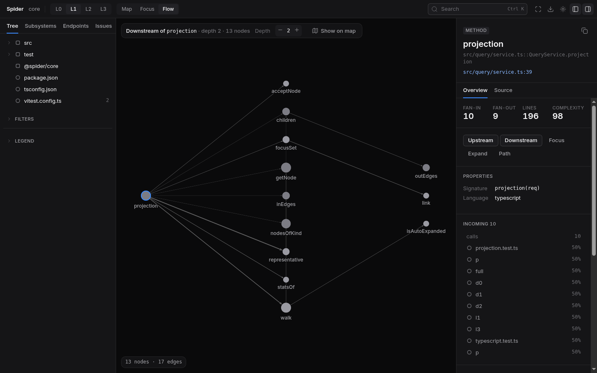
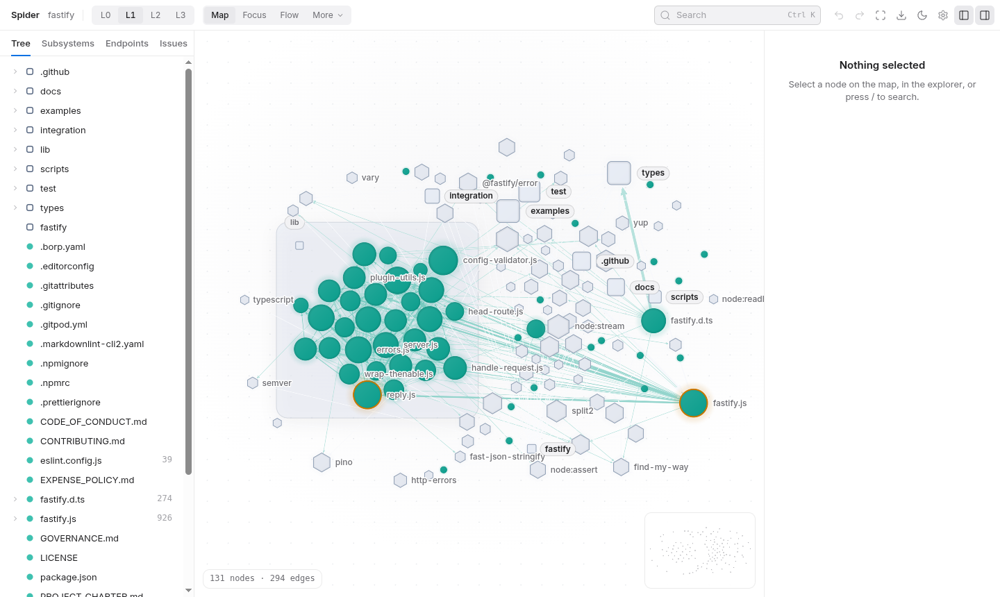

# Spider

See how your codebase is connected.

Spider analyses a repository — a local path or a GitHub URL — and builds a graph of its directories,
files, classes, functions, imports, calls, inheritance, dependencies and API endpoints. You explore
it as an interactive map: zoom from subsystems down to individual methods, trace an endpoint to the
database, or ask what breaks if a function changes.


## What it does

- **Map** at four levels: architecture (L0 subsystems), modules (L1), files (L2), symbols (L3).
  Double-click a container to open it in place; everything else keeps its position.
- **Focus** on one node: incoming relationships on the left, outgoing on the right.
- **Flow** queries: upstream impact, downstream dependencies, endpoint traces, and the shortest
  path between any two nodes (directories included).
- **Explorer**: file tree, subsystems, detected endpoints, and issues (import cycles, large hubs,
  unreferenced exports, orphan files). Filters for edge and node kinds, languages, tests and
  confidence.
- **Details**: metrics, properties, grouped relationships and the source of the selection.
- Languages: TypeScript, JavaScript and Python today, with route detection for Express, Fastify,
  Koa, Hono, NestJS, Next.js, FastAPI, Flask and Django.

Analysis is local: Spider never runs the code it reads and never writes outside its own home
directory (`~/.spider`, or `SPIDER_HOME`).

## Install

Requires Node 20 or newer and pnpm 9.

```bash
pnpm install
pnpm build
```

## Quick start

```bash
node packages/cli/dist/index.js analyze fixtures/ts-express   # or a path, a git URL, owner/repo
node packages/cli/dist/index.js open                          # serves http://127.0.0.1:4747 and opens it
```

Or analyse from the browser: run `node packages/cli/dist/index.js serve` and paste a path or GitHub
URL on the home page.

| Key | Action |
|-----|--------|
| `⌘K` / `/` | Search |
| `1`–`4` | Level L0–L3 |
| `F` / `Shift+F` | Fit all / fit selection |
| `U` / `D` | Upstream / downstream of the selection |
| `P` | Path (between two shift-selected nodes, or pick the second) |
| `H` / `Shift+H` | Hide selection / show hidden |
| `Esc` | Clear selection, close overlays |

## Command line

```bash
spider analyze <path|url|owner/repo> [--ref <ref>] [--name <name>] [--json]
spider list
spider stats <repo>
spider query <repo> search|upstream|downstream|path|endpoints|diagnostics|subsystems …
spider export <repo> --format json|dot|graphml [-o file]
spider diff [repo|path] --base main [--head HEAD] [--format md|json] [-o file]
spider serve [-p 4747] [--host 127.0.0.1]
spider open
```

`--home <dir>` works with every command.

### Graph diff and PR mode

`spider diff --base main` analyses `main` (from `git archive`, never touching your working tree) and
the working tree, and prints a Markdown summary of added/removed files, symbols and dependencies plus
new cycles and layer violations — ready for a PR comment (`--format json` for the full diff). In the web
app, **More ▾ → Compare with a revision…** draws the same diff on the map: added nodes and edges carry
green marks, removed ones come back faded with red marks. See
[`docs/examples/spider-diff.yml`](docs/examples/spider-diff.yml) for a GitHub workflow.

### VS Code

`packages/vscode` hosts the web app in a VS Code webview: **Spider: Open map**, **Spider: Reveal in
Spider** (symbol under the cursor) and "Open in editor" from the map back into VS Code. See its
[README](packages/vscode/README.md).

## Development

```bash
pnpm dev         # API on :4747 and Vite on :5173 (proxying /api)
pnpm typecheck
pnpm test
pnpm lint
pnpm bench       # pipeline timings on cached clones, or the fixtures
```

## Architecture

```
packages/shared   graph model, API types and request schemas
packages/core     discover → parse → extract → resolve → enrich → persist → query
packages/server   Fastify HTTP API (+ WebSocket job progress) and static web hosting
packages/cli      the spider command
packages/web      React + Sigma web app
packages/vscode   VS Code extension (webview of the web app)
fixtures/         small repos with hand-verified expected graphs
```

- [`design.md`](design.md) — product and architecture design.
- [`DESIGN_RULES.md`](DESIGN_RULES.md) — the visual design system.
- [`IMPLEMENTATION_PLAN.md`](IMPLEMENTATION_PLAN.md) — current state, invariants and the ordered
  roadmap.
- [`docs/API.md`](docs/API.md) — HTTP API reference.

## Roadmap

Phase 1 (foundation) is built. Next, per the plan: receiver typing from annotations, barrel
re-exports, a parse worker pool, incremental re-analysis, more frameworks (Phase 2); subsystem
overrides, git churn, layering and a dependency matrix (Phase 3); more languages and scale
(Phase 4); and an optional semantic layer (Phase 5).

| | |
|---|---|
|  |  |
